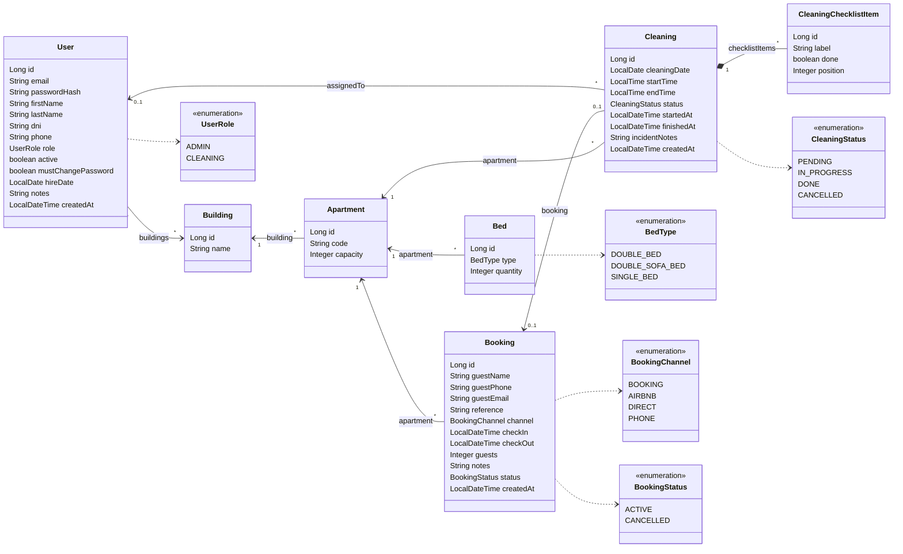
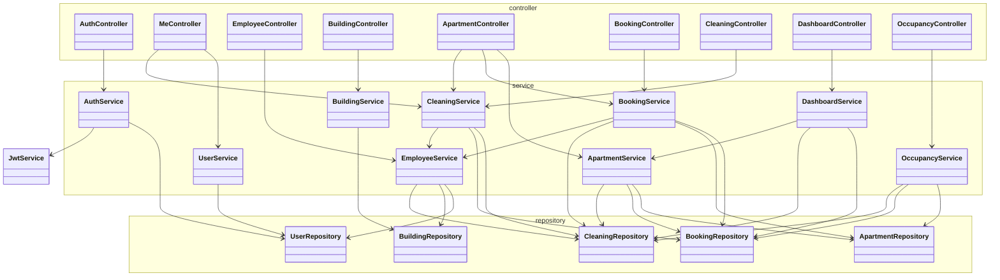
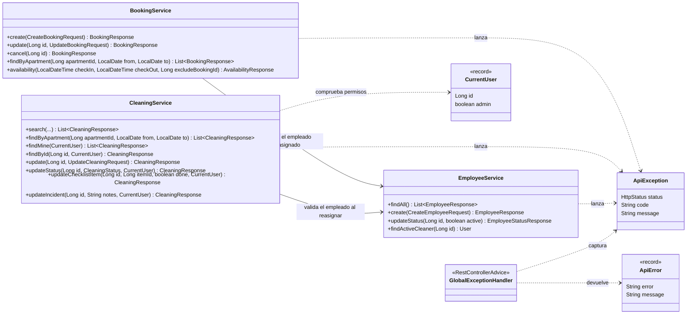

# Diagrama de clases

Tres vistas del backend, de lo más concreto a lo más general:

1. [Modelo de dominio](#1-modelo-de-dominio): las entidades JPA y sus relaciones.
2. [Capas](#2-capas): qué controlador usa qué servicio y qué servicio usa qué repositorio.
3. [Núcleo de reservas y limpiezas](#3-núcleo-de-reservas-y-limpiezas): los dos servicios con más lógica y el manejo de errores.

El esquema de la base de datos (tablas y columnas) está en [modelo-datos.md](modelo-datos.md).

## 1. Modelo de dominio

Entidades de `com.hotelhost.backend.entity`. Los getters y setters se omiten.

- Un **edificio** tiene apartamentos, y cada **apartamento** tiene sus camas; la suma de plazas es `capacity`.
- Una **reserva** es una anotación manual. El canal (`BOOKING`, `AIRBNB`…) es solo informativo: no hay integración con esas plataformas.
- Al registrar una reserva se puede programar la **limpieza** de su salida (`booking`). También puede haber limpiezas sin reserva.
- La limpieza tiene un **checklist** que se crea y se borra con ella (composición, `cascade = ALL`).
- `User` representa tanto al admin como a los empleados de limpieza (`role`). La baja de un empleado es lógica (`active = false`), para conservar su historial de limpiezas.

## 2. Capas

Cada petición pasa por `controller` (fino, solo HTTP) → `service` (toda la lógica de negocio) → `repository` (Spring Data JPA). Los controladores reciben y devuelven DTOs (`record`), nunca entidades.

Fuera de estas capas:

- **`security`:**
  - `JwtService` firma el token, con los claims `sub`, `role` y `exp`.
  - `PasswordChangeRequiredFilter` bloquea la API a los empleados que aún tienen la contraseña temporal.
  - `CurrentUser` es el usuario de la petición, sacado del JWT.
- **`config`:**
  - `SecurityConfig` define las rutas públicas, los permisos por rol y el JWT.
  - `CorsConfig` configura CORS.
  - `AdminInitializer` crea el primer admin si no existe.
- **`exception`:** el formato único de error, que se detalla abajo.

## 3. Núcleo de reservas y limpiezas

- **`BookingService`** evita las reservas solapadas dentro de una transacción. Primero bloquea la fila del apartamento (`findByIdForUpdate`, bloqueo pesimista); después comprueba el solape. Así, dos peticiones a la vez no pueden reservar las mismas fechas. Al crear la reserva puede programar la limpieza de la salida, y al cancelarla cancela también esa limpieza si está pendiente.
- **`CleaningService`** recibe el `CurrentUser` para aplicar los permisos en el backend: un empleado solo ve y modifica sus propias limpiezas, y el admin las de todos.
- **Errores:** los servicios lanzan `ApiException(status, "CODIGO", "mensaje")`. `GlobalExceptionHandler` la convierte en `{ "error": "BOOKING_OVERLAP", "message": "..." }`, el mismo formato que usará el backend en PHP.
