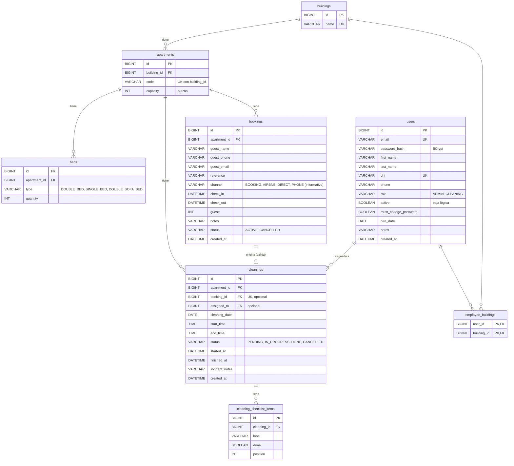

# Modelo de datos

Esquema en `src/main/resources/db/migration` (Flyway). SQL estándar compatible con MySQL 8 y MariaDB.

## Reglas

- Las reservas no se borran: se cancelan (`status = CANCELLED`). Lo mismo con las limpiezas.
- Los empleados no se borran: se dan de baja (`active = false`) para conservar su historial.
- Una reserva origina como mucho una limpieza (la de su salida).
- Las plazas (`capacity`) coinciden con la suma de camas: cama doble = 2, sofá cama doble = 2, individual = 1.
